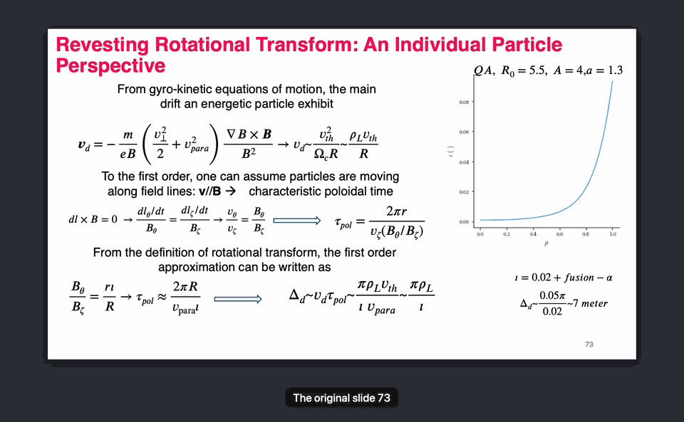

# BeamerX

BeamerX is a lightweight native editor for scientific presentations on
**macOS and Linux**. It combines a PowerPoint-style workspace with live LaTeX
math, editable vector graphics, presentation mode, and Beamer/PDF export.



## Install

No Rust compiler is required. The installer downloads the correct prebuilt
binary and verifies its SHA-256 checksum.

### macOS

Apple Silicon, macOS 11 or newer:

```bash
curl --proto '=https' --tlsv1.2 -LsSf https://raw.githubusercontent.com/moaziat/BeamerX/refs/heads/main/install.sh | sh
```

### Linux

x86_64 or ARM64 with glibc 2.35+ and X11/XWayland:

```bash
curl --proto '=https' --tlsv1.2 -LsSf https://raw.githubusercontent.com/moaziat/BeamerX/refs/heads/main/install.sh | sh
```

BeamerX is installed to `~/.local/bin/beamerx`. The installer prints the one
PATH command to run if `~/.local/bin` is not already available in your shell.
Set `BEAMERX_INSTALL_DIR` for a different destination or
`BEAMERX_VERSION=v0.1.2` for a specific release.

## Highlights

- PowerPoint-style ribbon, slide thumbnails, layouts, sections, and themes.
- Direct text editing with font family, size, colour, emphasis, alignment,
  bullets, numbering, and outline levels.
- Live inline and display LaTeX using `$...$` and `$$...$$`.
- Images with fit, aspect sizing, resize controls, and front/back ordering.
- Shapes, arrows, line ends, dash styles, and 3D-style primitives.
- Multi-selection, alignment, snapping, copy/paste, undo/redo, zoom, and pan.
- Editable `.beamerx` projects with packaged, deduplicated image assets.
- Full-screen presentation plus self-contained Beamer and PDF export.
- Autosave recovery and bounded background work for responsive editing.

## Quick start

- Double-click empty slide space to add text, or press `T` for a text box.
- Write `$E = mc^2$` inline or `$$\int_0^1 f(x)\,dx$$` as display math.
- Drag PNG/JPEG files onto a slide or use **Insert › Picture**.
- Add shapes from **Home › Drawing** or **Insert › Shapes**.
- Use **Home › New Slide** and **Layout** to structure the deck.
- Save with `⌘S` and export from the **File** menu.
- Present with `⌘↩`; use arrows, space, or click to advance.
- Standard shortcuts include `⌘N/O/S`, `⌘Z`/`⇧⌘Z`, `⌘X/C/V`, `⌘A`, `⌘D`,
  and `⌘B/I` while editing text. Use Ctrl instead of Command on Linux.

## LaTeX

The editor works without LaTeX, but live equation previews and PDF export need
one of these engines:

- [Tectonic](https://tectonic-typesetting.github.io/) (recommended)
- XeLaTeX, LuaLaTeX, or pdfLaTeX from TeX Live/MacTeX

On macOS, Tectonic can be installed with:

```bash
brew install tectonic
```

BeamerX searches `PATH`, `/opt/homebrew/bin`, `/usr/local/bin`,
`/Library/TeX/texbin`, and `~/.cargo/bin`. Set
`BEAMERX_LATEX=/path/to/engine` to choose an engine explicitly.

## Build from source

Rust is only needed for source builds. Install Rust and Cargo with the official
`rustup` installer, then clone and run BeamerX:

```bash
curl --proto '=https' --tlsv1.2 -sSf https://sh.rustup.rs | sh
git clone https://github.com/moaziat/BeamerX.git
cd BeamerX
cargo run --release
```

Linux source builds also need OpenGL, X11, XKB, and pkg-config development
packages. On Ubuntu/Debian:

```bash
sudo apt-get update
sudo apt-get install libgl1-mesa-dev libx11-dev libxi-dev libxkbcommon-dev pkg-config
```

## Project and export format

A `.beamerx` file is a validated ZIP container containing versioned project
JSON and original image assets. Saves are atomic and older project versions
are migrated when opened.

Beamer export creates `main.tex` plus an `images/` directory. Objects are
placed in slide-space coordinates with TikZ, and stock themes emit their real
`\usetheme{...}` command. PDF export compiles the same Beamer source in the
background.

## Known limitations

- macOS releases currently support Apple Silicon only.
- Rotation, cropping, grouping, animations, speaker notes, Beamer import,
  PowerPoint import, collaboration, and cloud sync are not available yet.
- Opening `.beamerx` files by double-clicking in Finder is not wired up; use
  **File › Open**, drag the file onto BeamerX, or pass it on the command line.
- LaTeX is external and is not bundled with the application.

## Development

```bash
cargo fmt --all --check
cargo clippy --locked --all-targets -- -D warnings
cargo test --locked --all-targets
cargo run --release -- --bench smoke
scripts/measure.sh
```

See [`docs/PERFORMANCE.md`](docs/PERFORMANCE.md) for measured performance.
